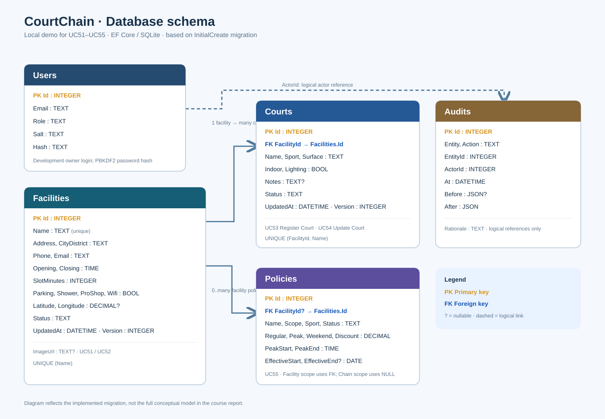

# Cấu trúc database

Hồ Tuấn Minh · HE191253 · SE1990NJ

Sơ đồ phản ánh hai migration InitialCreate và AdministrationRevisions. File SQL: `../database/CourtChain.sql` (SQLite).

- Facilities 1–N Courts, mỗi sân có FacilityId bắt buộc.
- Facilities 1–N Policies theo phạm vi cơ sở; policy toàn chuỗi có FacilityId=null.
- Audits lưu actor, before/after, thời gian và rationale. ActorId/EntityId là tham chiếu logic, không có khóa ngoại.
- Version ở Facilities/Courts dùng kiểm tra cập nhật đồng thời; ImageUrl là đường dẫn ảnh HTTPS tùy chọn.
- Số tiền dùng decimal ở C#, SQLite lưu TEXT theo EF provider để giữ chính xác.
