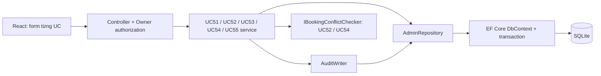

# Design patterns — Hồ Tuấn Minh, HE191253, SE1990NJ

Thiết kế giữ đơn giản: **Controller → Use-case Service → Repository → EF Core → SQLite**.

| Pattern / kỹ thuật | Code | Vai trò trong 5 UC |
|---|---|---|
| Repository | `backend/Data/AdminRepository.cs` | Tập trung đọc dữ liệu, tìm trùng, thêm bản ghi và lưu; dùng trong cả UC51–UC55. |
| Unit of Work | `AppDb`, `AdminRepository.Begin/Save` | Entity và audit được commit cùng một transaction; batch UC53 thất bại thì không tạo một phần. |
| Application Service | `backend/UseCases/UC51_...` đến `UC55_...` | Mỗi lớp thực hiện một use case, controller chỉ nhận DTO, gọi service và trả response. |
| Dependency Injection | `backend/Program.cs` | Cấp repository, audit writer, clock và booking checker; dễ thay thế khi kiểm thử. |
| Strategy qua interface | `IBookingConflictChecker` | UC52/UC54 phụ thuộc hợp đồng kiểm tra booking. Bản demo dùng `BookingModuleNotInstalled`, khai báo Available=false; chưa phải bộ kiểm tra booking thật. |
| DTO | `backend/Contracts` | Tách dữ liệu API khỏi entity; request cập nhật không có ID, FacilityId/Sport của sân, tránh thay đổi danh tính. |
| Component composition | `frontend/src/components`, `features` | Form và trang của từng UC tái sử dụng Field, Modal, FormActions; không lặp toàn bộ giao diện. |

Không gọi mỗi tên lớp là một GoF pattern. Repository, Unit of Work và Application Service là các pattern kiến trúc ứng dụng được dùng trực tiếp ở đây.

Luồng chung: xác thực chủ sân → kiểm tra dữ liệu → kiểm tra trùng / phiên bản → thay đổi dữ liệu → ghi audit → commit → UI nạp lại dữ liệu. Với lỗi validation hoặc trùng, trả 400/409 và hiển thị ngay trong form.
